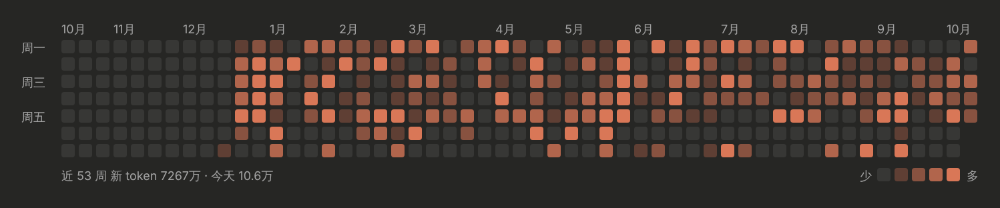
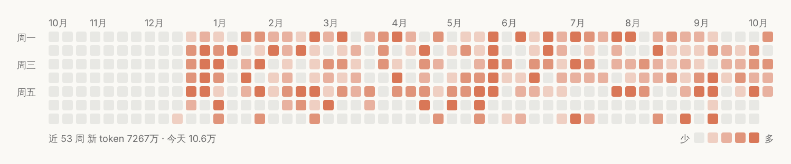

# usage-heatmap

一个 Claude Code mod：把每天用掉的 token 画成一张小方格图，像 GitHub 贡献图那样，一个日期一个格子，颜色越深用得越多，鼠标悬停显示那天的日期和数字。复刻的是 Claude 桌面版（2.42304.0 之前）新建对话页上的那张格子图。




<sub>上面两张图用的是造出来的示例数据，由本 mod 生成的 SVG 在浏览器里截的；真正在 Claude 桌面版里的样子要装好以后看。</sub>

## 显示在哪

插件画不到桌面版自己的「新建对话」选择页（那时还没有会话在跑，插件接口里也没有这个位置），所以放在最接近的两处：

- **输入框上方**：新会话还没进行任何一轮时（刚打开新对话、还没发第一条消息）显示格子图，第一轮结束后自动收起；`/clear` 之后又会出现。有调查问卷时让位。和别的插件（比如 token-usage）同时画在这里时，别人的内容在上、格子图在下，两者都保留。
- **`/heatmap` 命令**：随时打开一个面板，看完整的格子图和汇总：总 token、会话数、当前连续天数、最长连续天数、最活跃的一天，还有「刷新」按钮。

桌面版画成 SVG（悬停每个格子有提示）；终端里用 `·░▒▓█` 字符画：

```
     10月  11月    12月      1月     2月     3月       4月     5月     6月       7月     8月       9月     10月
周一 · · · · · · · · · · ░ ▒ ░ · ▓ ▓ ▒ ▒ ░ █ ▒ █ · ▒ ▓ █ ▒ · ▓ · ░ ░ █ · █ ░ █ ▒ █ ▓ ▒ █ █ · ▒ ▓ ▒ ▒ ░ · · · ▓
     · · · · · · · · · · ▓ █ ▓ █ · ░ █ ▒ █ ░ · ░ ▒ · ▓ · ░ █ · ░ ▓ ░ █ · · ░ █ ▒ · ░ · ▒ · · █ ░ ░ ░ ▓ ▒ ░ ▓ ·
周三 · · · · · · · · · · ▓ █ █ · ▒ █ · ░ · ░ ▓ ▓ ░ · ▓ ░ · ▓ ▒ · · ▒ █ ▓ · ▓ ▓ ░ █ ▓ · ▒ ▒ ▒ ▒ ░ ▒ ░ · ▒ ▒ ▓ ▓
     · · · · · · · · · · ▓ █ ▓ · █ · ░ ▒ · ░ ▒ ░ ▒ · · █ · ▒ · ░ ▓ ▓ █ ░ ░ █ · ▒ ▒ ▒ ▒ · ░ ▒ ▒ ▓ ░ ▓ █ ░ ▓ ▒ ▒
周五 · · · · · · · · · · █ █ ░ · ▒ █ ░ ▓ █ █ ░ ▓ ▒ ▓ · ▓ ▓ ▓ ░ ▓ ▓ █ █ · ▒ ▒ ░ ░ · · · █ █ ▓ · · ▒ █ █ · ░ █
     · · · · · · · · · · ▒ · █ · · · · ▒ ▓ ░ █ · · ▒ · · · █ · █ · █ · · · · · · · · · · · · · · · · ░ · · ·
     · · · · · · · · · ░ · · ▓ · · ▓ · · · ▓ · · · · · · · · ▓ · · ▓ · ░ ▒ · · ░ █ ▒ · · · · ▓ · █ · █ · · ·
近 53 周 新 token 7256万 · 今天 4.1万                                                              少 ·░▒▓█ 多
```

最近 53 周，列是周、行是周一到周日；放不下时按宽度少画几周，终端里高度不够时只画一行最近几十天。

## 本地安装（macOS）

1. 需要 `python3`（3.8 以上；macOS 自带的 `/usr/bin/python3` 就行，没有的话先跑 `xcode-select --install`）：

   ```sh
   python3 --version
   ```

2. 克隆到 mods 目录：

   ```sh
   git clone https://github.com/dantelin000/claude-mod-usage-heatmap.git ~/.claude/mods/usage-heatmap
   ```

   （仓库是私有的，克隆要用有权限的 GitHub 账号；用 SSH 的话把地址换成 `git@github.com:dantelin000/claude-mod-usage-heatmap.git`。）

3. 在 `~/.claude/settings.json` 的 `env.CLAUDE_CODE_PLUGIN_DIRS` 里追加这个路径，macOS 用冒号分隔。原来是 `/Users/dante/.claude/mods/token-usage` 的话，改成：

   ```json
   {
     "env": {
       "CLAUDE_CODE_PLUGIN_DIRS": "/Users/dante/.claude/mods/token-usage:/Users/dante/.claude/mods/usage-heatmap"
     }
   }
   ```

   只改这一个键，`settings.json` 里别的内容保持不动。

4. 开一个新会话（桌面版点新建对话，或终端里重新运行 `claude`）。格子图会出现在输入框上方；任何时候都可以输入 `/heatmap` 打开面板。

以后更新：`git -C ~/.claude/mods/usage-heatmap pull`，再开新会话。

### 如果只看到 token-usage 的条，没有格子图

本 mod 会先让下面的插件画完、把它们的内容放在上面，再把格子图接在下面。但如果 token-usage 排在它上面、而且它的 `AbovePrompt` 钩子没有调用 `next(e)`，它就会把下面的内容都盖掉。两个办法：在 token-usage 里先 `const below = await next(e)`，再把自己的内容和 `below` 一起返回；或者在 `CLAUDE_CODE_PLUGIN_DIRS` 里调换两个路径的顺序试试。

## 用量怎么算

- **数据来源**：`~/.claude/projects/<项目目录>/<会话id>.jsonl`，以及每个会话目录下 `subagents/` 里子代理的记录（设了 `CLAUDE_CONFIG_DIR` 时用它下面的 `projects/`）。
- **按回复去重**：一条回复在记录里会拆成好几行，每行带同一份 `usage`，所以按 `message.id`（没有就用 `requestId`）只算一次；恢复会话时复制到新记录里的旧回复也只算一次。
- **按本地时区分天**：时间戳是 UTC，按电脑当前时区换成日期。
- **格子颜色**默认按「新 token」＝未缓存输入＋缓存写入＋输出。缓存读取每天能到上亿，算进去会把色阶压扁，所以默认只出现在悬停提示里。
- **分 5 档**：没用量是一档，其余按当前图里有用量的日子分四等份（分位数，和 GitHub 一样），不是线性。

汇总由 mod 自带的 `scripts/aggregate.py` 在后台算（插件读不了超过 4 MiB 的文件，而长会话的记录常常更大）：会话开始时跑一次，之后每 10 分钟、每轮对话结束（距上次超过 1 分钟）、按「刷新」时再跑。它按文件路径＋大小＋修改时间做缓存，只重读变了的文件；只是变长了的文件只读新增的部分。缓存在 `~/Library/Caches/claude-usage-heatmap/aggregate-v1.json`（Linux 是 `~/.cache/…`），删掉就会全部重算。上一次的结果另外存在插件自己的存储里，新会话一打开就能先显示，后台算完再更新。

在 80 个、共 253 MB 的造出来的记录上（19 个超过 4 MiB），第一次全量约 0.8 秒，之后约 0.1 秒。

## 设置

在 `/config` 里能看到这几项，也可以写进 `~/.claude/settings.json`：

```json
{
  "pluginConfigs": {
    "usage-heatmap": {
      "options": { "metric": "new", "palette": "claude", "python": "python3" }
    }
  }
}
```

| 选项 | 取值 | 说明 |
| --- | --- | --- |
| `metric` | `new`（默认）／`all` | 格子颜色按新 token 算，还是连缓存读取一起算 |
| `palette` | `claude`（默认）／`green` | Claude 的橙色，或 GitHub 的绿色 |
| `python` | 默认 `python3` | 跑汇总脚本用的解释器，可以写绝对路径 |

## 开发

```
.claude-plugin/plugin.json   清单（名字、userConfig、state 合约的位置）
hooks/hooks.json             指向 register.tsx
hooks/register.tsx           钩子：会话开始、轮次结束、/heatmap、输入框上方的横条和面板
hooks/heatmap.ts             不碰 $ 的部分：日期、分档、连续天数、SVG 和终端字符画
types/index.d.ts             $.state 的类型合约
scripts/aggregate.py         汇总会话记录，输出按天的 JSON
tests/heatmap.test.tsx       claude plugin test 跑的测试（Python 的输出用假数据代替）
tests/test_aggregate.py      aggregate.py 的测试，用造出来的 jsonl
```

全部检查一次：

```sh
scripts/check.sh
```

它依次跑 `claude plugin validate .`、`tsc -p .`、`claude plugin test .` 和 `python3 -m unittest discover -s tests`。`tsc` 用到的类型文件在 `.claude-plugin/types/`，Claude Code 第一次加载这个 mod 时会自动生成（已在 `.gitignore` 里）。去重、跨天和时区这些汇总逻辑在 `tests/test_aggregate.py` 里测；`claude plugin test` 的环境不能起子进程，所以那边把脚本的输出当成假数据喂进去，测显示、时区换算后的「今天」、空状态和与别的插件叠放。
